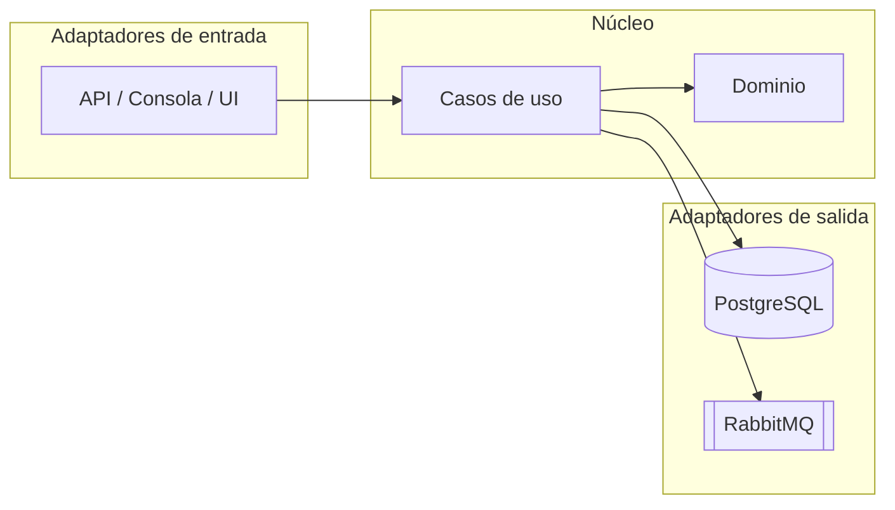

# Arquitectura

Lumia usa arquitectura hexagonal (puertos y adaptadores), principios SOLID e inyección de dependencias por constructor. La configuración se inyecta con el patrón Options.

Proyectos del backend: `Lumia.Domain` (dominio), `Lumia.Application` (casos de uso y puertos), `Lumia.Infrastructure` (adaptadores de salida y registro de dependencias), `Lumia.Api` y `Lumia.Workers` (adaptadores de entrada). PostgreSQL y RabbitMQ aún no se utilizan.

