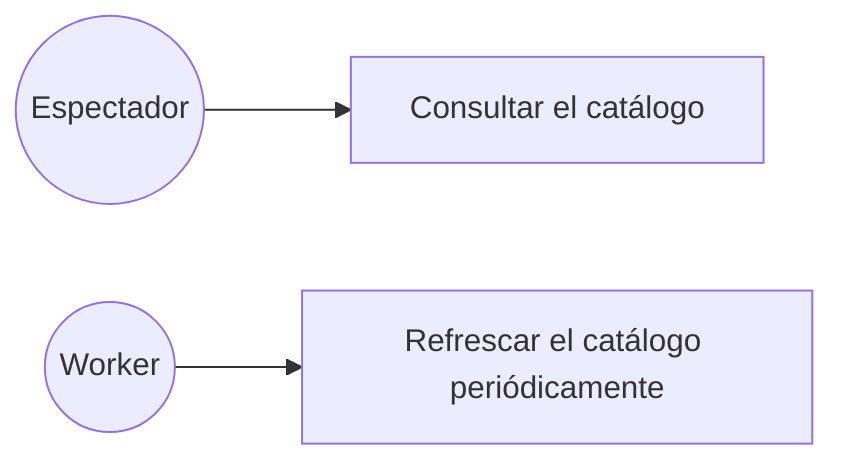

# Casos de uso

| Caso de uso | Descripción | Punto de entrada |
|:------------|:------------|:-----------------|
| Consultar el catálogo | Lista el contenido ordenado por título | `GET /api/v1/content`, interfaz web |
| Refrescar el catálogo | Lee periódicamente el catálogo (cada 5 minutos) | `Lumia.Workers` |
